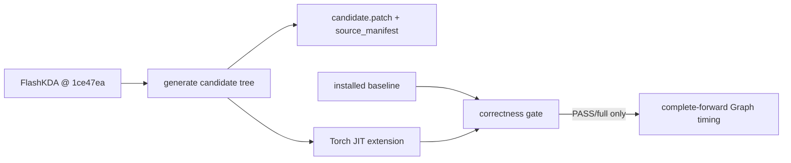

# Design of the harness and the three routes

This document explains how the code is organised and why each measurement is
constructed the way it is.  The formal results are in
[report.zh.md](report.zh.md); the evidence boundaries are in
[evidence.md](evidence.md).

## 1. Upstream is read-only

FlashKDA is not vendored.  `scripts/fetch_upstream.sh` clones the upstream
repository and checks out `1ce47ea` plus CUTLASS `5c149f5`.  Every route
generates a **new source tree** under `runs/build/<UTC>/<route>/csrc`, writes a
`candidate.patch` and a `source_manifest.json`, and compiles that tree as a
separate Torch JIT extension.  The installed baseline is never modified,
replaced or shadowed.

Each patch anchor asserts its hit count:

```python
replace_exact(k2, "#include \"utils.cuh\"", "...")
# RuntimeError if the anchor appears 0 or 2 times
```

The six recorded source hashes are checked before generation (LF-normalised, so
a CRLF checkout is not mistaken for a new revision).  If upstream changes, the
run stops; it does not produce a "close enough" kernel.



## 2. Route A: Phase 6 only

Route A keeps K1, Phases 1-5, `CHUNK=16`, the BF16 state rounding boundaries and
the output layout.  It replaces the Phase-6 `KR^T @ U` with one
`tcgen05.mma` (`m128n128k16`) and reads the result back from TMEM.

The hard part is not the instruction; it is the hand-off:

1. The original compute warps keep `U` in registers.  tcgen05 needs a shared
   memory operand, so the real BF16 `U` is written once into a `VOLayout`-shaped
   buffer.
2. `KR^T` and `U` are packed into the descriptor layout measured in the
   standalone Phase-6 probe.  Every element is covered exactly once; the
   integer map is checked offline.
3. One TMEM allocation per CTA is made before the chunk loop and released after
   the last chunk.  Allocation per chunk would dominate the measurement.
4. Only the 128 compute threads participate in the named barrier.  Waiting for
   all 192 threads (including the load/store warps) would deadlock the
   pipeline.
5. The epilogue keeps the original `BF16_RN(FP32_FMA(state, gate, AB))`.

`A_control` runs the same U staging, packed layouts, barriers and epilogue, but
uses `mma.sync` instead of tcgen05.  The difference between baseline and
control is the cost of the rewritten data path; the difference between control
and A is the instruction change.  Neither difference isolates every hardware
effect, and the report says so.

## 3. Route B: large chunk with relative-prefix rebasing

The naive way to enlarge a chunk is to keep the absolute prefix
`exp(G_i) * exp(-G_j)`.  With strongly negative gates this materialises 0 and
Inf before multiplying them.  Route B computes the causal difference directly:

```text
E_ij = exp(G_i - G_j),  i >= j,  G_i - G_j <= 0
```

and masks non-causal positions **before** `exp`.  Within a chunk:

```text
L_ij = beta_i * sum_d k_id k_jd E_ijd          (i > j, diagonal 0)
R_i  = beta_i * (v_i - (k_i * exp(G_i)) S_0)
(I + L) U = R
O_i  = (q_i * exp(G_i)) S_0 + sum_{j<=i} (sum_d q_id k_jd E_ijd) U_j
S_1  = diag(exp(G_C)) S_0 + sum_j (k_j * exp(G_C - G_j)) U_j^T
```

`I+L` is unit lower triangular, so the implementation uses an FP32 triangular
solve instead of the FP16 Neumann series.  The chunk size is real: C32/C64 are
not decomposed into C16 sub-blocks, and the state is only rounded at the full
chunk boundary.

v1 (`b_rescale.py`) is a PyTorch CUDA composite: it materialises a
`[H,C,C,D]` intermediate and calls library kernels.  v2
(`experiments/b2_fused_triton/`) fuses it into three Triton kernels.  Both are
kept because the v1 cost is an implementation cost, not a bound on a fused
kernel.

## 4. Route C: value-column split

Write the state as `S = [S^(0) S^(1)]` and the value vector as
`v = [v^(0) v^(1)]`.  Then for each shard `p`:

```text
dv_t^(p) = v_t^(p) - (S_bar_t^(p))^T k_t
S_t^(p)  = S_bar_t^(p) + beta_t k_t (dv_t^(p))^T
```

The right-hand side only needs the shard's own state plus the shared
`q/k/g/beta`; the key reduction is complete.  This is why the column split
needs no cross-CTA reduction.  Splitting the key dimension would not have this
property.

The patch changes:

- K2 grid `(N,H)` -> `(N,H,2)`;
- value/output/state tile 128 -> 64 columns;
- threads 192 -> 128 (2 compute + 1 load + 1 store warp);
- TMA descriptors and the state cast helper to a rectangular `64x128` shape;
- a `layout_info()` host check that enumerates the real CuTe layouts.

K1 and `utils.cuh` are byte-identical.  Each CTA still reads the shared q/k/gate
data, so the route pays duplicate I/O and extra I/O warps.  That is the cost
side of the ledger.

## 5. Correctness gate

`correctness.py` builds every implementation from the same fixture and seed.
It runs the **pinned FLA `naive_recurrent_kda`**, not a reimplementation, and
checks the full output and the returned final state.  The initial state is
cloned and compared bitwise afterwards; a candidate that mutates it is stopped
immediately.

Pre-registered gates:

| Route | Gate |
|---|---|
| A / A_control | vs baseline NRMSE <= 0.005 and max_abs <= 0.01, finite, plus FLA envelope |
| B16/32/64 | vs FLA NRMSE <= 0.005 and max_abs <= 0.01, finite, FP32 state/solve |
| C | bitwise equal to baseline including final state, plus FLA envelope |
| all | no non-finite values; initial state unchanged |

The FLA envelope is
`NRMSE <= min(0.05, max(0.015, 1.10*baseline_NRMSE + 0.001))` and
`max_abs <= max(0.02, 1.10*baseline_max_abs + 0.002)`.  It gives the original
approximation room while keeping a 5% ceiling.  These are engineering filters,
not model-quality thresholds.

`full` is 38 cases per implementation: seven state-interface modes, fixed and
varlen, batch 2, ten tail lengths, five gate regimes including zero q/k, two
short grids (H12/H96), four T8192 shapes and a weak-forgetting long chain.
The v1 run produced 420 output/state comparisons and 228 initial-unchanged
records, all passing.

## 6. Timing gate

`benchmark.py` refuses to load a candidate unless the same build has a
`PASS/full` verdict, and it re-checks the runner source manifest and binary
hash.  For each shape:

1. warm up eagerly five times and capture one complete forward into a CUDA
   Graph (three graph warmups);
2. verify graph output equals eager output bitwise;
3. time 12 rounds, alternating baseline/candidate order each round;
4. poison every output and state element with NaN, replay, and require exact
   recovery;
5. verify the read-only initial state is unchanged.

The graph includes input normalisation, gate/beta activation, prepare,
recurrence and output/state writes.  Python submission, out-of-graph allocation
and host descriptor construction are excluded.  Clocks are not locked, buffers
are reused and caches are not flushed; this is a relative comparison under one
consistent protocol, not an absolute latency claim.

## 7. Why H12 matters

K3 uses 96 heads; with TP8 each GPU sees 12.  The recurrence kernel launches
one CTA per head, so fixed H96 gives 96 CTAs on 148 SMs, and H12 gives 12.  The
column split doubles those numbers, but only H12 is far enough below the SM
count for the extra CTAs to improve whole-GPU coverage.  This is also why H12
is reported as a single-GPU shape and never as an 8-GPU serving result.
